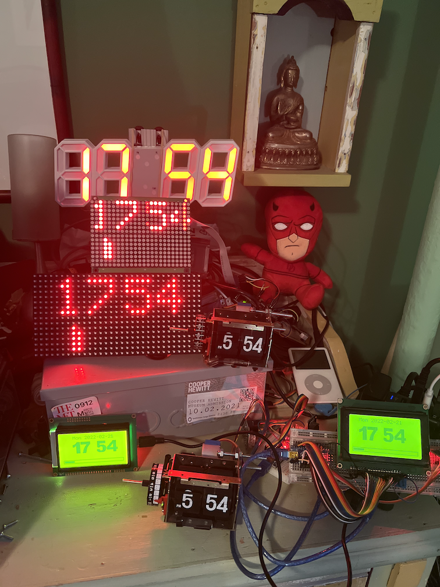
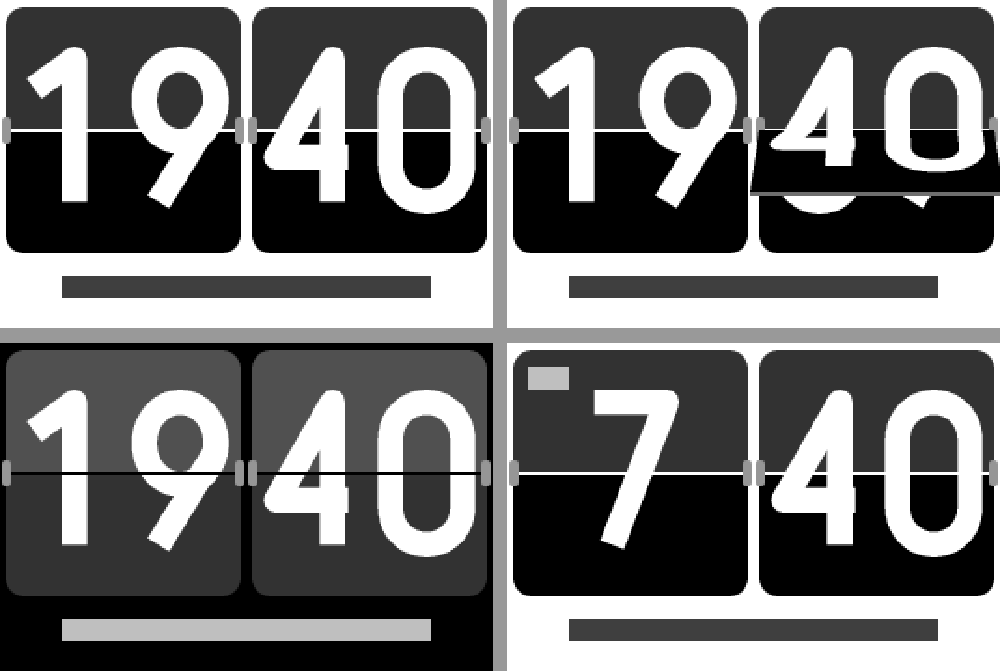

# arduinoclocks
Various Arduino sketches implementing RTC-based clocks with different displays.

Includes [ClockBlog](https://dpwe.github.io/arduinoclocks/)

## Badger 2350 flip clock

[badger2350_flipclock](badger2350_flipclock/) is a split-flap style clock app for the
badgewa.re / Pimoroni Badger 2350 e-ink badge (MicroPython), with host-side
scripts to install it and set the RTC over USB.

